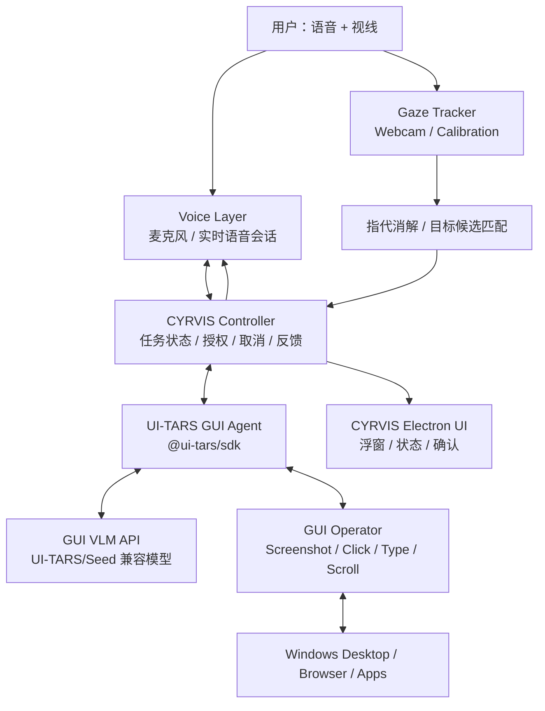

# CYRVIS — 技术架构与两周 Demo 开发方案（归档 v1）

> **归档说明（2026-11-15）**：这是项目最初的产品愿景与 14 天计划，部分内容已被实现取代。
> 当前实现请看 [../architecture.md](../architecture.md) 与 [../voice-architecture.md](../voice-architecture.md)；
> 后续重点见 [../roadmap.md](../roadmap.md)。本文保留用于理解需求背景。

> **文档版本**：v1.0  
> **日期**：2026-11-14  
> **目标平台**：Windows PC（单显示器优先）  
> **开发周期**：14 天  
> **核心方向**：在成熟 GUI Agent 基座上实现 **Voice + Gaze + GUI Control** 的实时、可交互桌面助手。

---

## 0. 一句话定义与技术决策

**CYRVIS = UI-TARS Desktop（GUI Agent 基座） + CYRVIS Controller（交互协调层） + Voice（语音交互） + Gaze（眼动定位）。**

### 已确定的关键决策

| 项目 | 决定 | 说明 |
|---|---|---|
| **主要开源基座** | **ByteDance [UI-TARS Desktop](https://github.com/bytedance/UI-TARS-desktop)** | Fork/复用其 Electron 桌面项目、`@ui-tars/sdk`、GUI 执行循环及 Operator |
| GUI 执行模型 | **UI-TARS SDK 支持的 GUI VLM** | 首选已验证的 UI-TARS / Seed 系列兼容模型服务；需单独配置 `baseURL`、`apiKey`、`model`，**基座不是自带一个随时可用的云端模型** |
| 语音 | 独立 **Voice Layer** | 可选择实时语音 API（如 OpenAI Realtime / GPT-Live）或 ASR + LLM + TTS；**技术架构不与某一家语音模型绑定** |
| 眼动 | **WebGazer.js** 原型 + 校准/坐标映射 | 普通摄像头先验证“看着目标，说打开这个”；不把眼动预测坐标视为精确点击指令 |
| 协调层 | **CYRVIS Controller（TypeScript）** | 负责工具调用、任务状态、取消、眼动指代消解与语音反馈；尽量复用 Electron/Node.js 生态 |
| 首期范围 | **GUI + Voice + Gaze** | 不开发完整 Terminal/Coding Agent、复杂长期记忆、跨设备、模型微调 |
| 后续可扩展 | Terminal Agent Adapter | 将代码/终端任务交给开源 Coding Agent，但**不进入本次两周开发范围** |

> **维护风险（重要）**：UI-TARS Desktop 仓库已于 **2026-11-09** 被官方归档为只读。继续选择它是为了快速复用已实现的 GUI 基座，不代表它仍在持续维护。第一天必须验证 Windows 运行、模型服务和 SDK；成功后固定可用 commit、依赖与 API 配置。若应用集成难以修改，可优先使用同仓库的 `@ui-tars/sdk` 构建较薄的 CYRVIS 外壳。

---

## 1. 产品 Demo 目标

最终演示体验：用户对 Windows 电脑自然说话，CYRVIS 能理解指令、实际操作图形界面，执行时持续显示状态；用户能要求暂停/取消，并通过眼动 + 语音指向屏幕上的对象。

### 必须实现（MVP / P0）

1. **GUI Agent 可用**：用文本命令操作电脑（打开浏览器、定位 UI、点击和输入、确认操作结果）。
2. **语音下发任务**：例如“CYRVIS，打开浏览器并搜索 UI-TARS”。
3. **执行反馈**：桌面 UI 展示 `Listening / Executing / Done / Failed`，并能用语音或文字返回结果。
4. **中断与取消**：用户能通过按钮或语音请求停止；后端实际停止继续派发动作，而不只是停止语音播放。
5. **基础眼动指代**：用户注视预先选定的窗口/按钮，说“打开这个”；系统显示识别目标、必要时二次确认，再操作。

### 尽力实现（P1）

- 非阻塞式语音交流：GUI Agent 工作时仍可接收简单语音指令和停止请求。
- 简洁的 CYRVIS 悬浮窗、语音状态动画、可视化 gaze 点/候选框。
- 3–5 个稳定、可重复演示的跨窗口场景。

### 本次明确不做（Out of Scope）

- 从零训练 GUI VLM / 眼动模型；
- 自研完整 Coding/Terminal Agent；
- 复杂多 Agent 路由、跨设备同步、长期用户画像；
- 允许 AI 无限制执行 Shell 命令或自动进行高风险操作；
- 未经验证地宣称“任意软件、任意屏幕、任意用户均可精准眼动控制”。

---

## 2. 基座到底是什么？已有功能 vs 我们新开发的功能

### 2.1 UI-TARS Desktop 提供的内容

官方项目是 **Electron + React/TypeScript** 桌面应用，其下层有 `@ui-tars/sdk` GUI Agent 和桌面 Operator（示例为 `nut.js`）。SDK 的典型调用方式：

```ts
import { GUIAgent } from '@ui-tars/sdk';
import { NutJSOperator } from '@ui-tars/operator-nut-js';

const controller = new AbortController();
const guiAgent = new GUIAgent({
  model: {
    baseURL: process.env.GUI_MODEL_BASE_URL!,
    apiKey: process.env.GUI_MODEL_API_KEY!,
    model: process.env.GUI_MODEL_NAME!,
  },
  operator: new NutJSOperator(),
  signal: controller.signal,
  onData: ({ data }) => {
    // SDK 状态和增量消息；接入 CYRVIS 事件总线
    console.log(data.status);
  },
  onError: ({ error }) => console.error(error),
});

await guiAgent.run('Open Chrome and navigate to github.com');
// 用户取消时：controller.abort()
```

**SDK 的核心循环（现有能力）**：

```text
用户任务（文本）
   ↓
GUIAgent.run(instruction)
   ↓
Operator.screenshot() → GUI VLM → 预测 click/type/scroll 等动作
   ↓
Operator.execute(action) → 再次截图 / 继续判断
   ↓
Agent 状态与执行结果
```

**基座已有**：Electron 应用框架、截图、GUI VLM 调用、鼠标/键盘操作、Agent Loop、状态回调、`AbortSignal` 取消机制。

**基座不应被视为已具备**：CYRVIS 所需的实时双向语音对话、语音任务委派、摄像头眼动、眼动与 GUI 元素关联、语音/GUI 任务级并发管理。这些是我们的开发内容。

> “Natural language control” 在 UI-TARS 官方 README 中主要是自然语言文本指令，并**不能直接等同于原生语音控制**。

### 2.2 模型配置和框架的区别

- **UI-TARS Desktop / SDK 是程序基座**：提供 Agent Loop、截图和鼠标/键盘工具。
- **GUI VLM 是推理模型**：结合指令与截图决定下一步操作；需要实际可用的模型端点及凭据。接口表面上可接 OpenAI-compatible API，但**模型本身必须适配 GUI 动作格式**，不是任意聊天模型都能直接替换。
- **Voice 模型/语音流水线是另一套能力**：负责听说和会话状态；与 GUI VLM 可以是两个独立服务。
- **Gaze 不是 GUI VLM**：眼动组件提供有噪声的注视信息，最终还须融合 GUI 当前截图/候选元素与用户指令。

---

## 3. CYRVIS 总体架构



**核心原则**：UI-TARS 保持原有 GUI Agent Loop；CYRVIS Controller 不重写鼠标/键盘规划，而是负责外层**多模态交互与任务生命周期**。

### 3.1 模块职责

| 模块 | 输入 | 输出 | 我们需要做的工作 |
|---|---|---|---|
| Voice Layer | 麦克风音频、当前会话 | `task_request`、`cancel_request`、语音回复 | 语音连接、唤醒/按键输入、打断、结果朗读 |
| Gaze Tracker | 摄像头帧、校准参数 | `(x, y, confidence, timestamp)` | 摄像头授权、校准、平滑、有效性检查 |
| Gaze + Screen Fusion | gaze、当前截图/窗口候选、语音中的“这个” | `target_hint` 或澄清请求 | 注视区域映射、目标高亮、确认机制 |
| CYRVIS Controller | 语音任务、target hint、GUI 状态 | 执行/取消命令、状态事件 | 统一任务 ID、单任务互斥、超时、错误处理 |
| UI-TARS GUI Agent | 文字任务及可选上下文 | GUI 动作、执行进度与结果 | 复用 SDK，适配其外部调用接口 |
| CYRVIS UI | 任务与语音状态 | 浮窗、确认、停止按钮 | 在既有 Electron/React UI 上小范围改造 |

### 3.2 重要：交互层与执行层解耦

原版 UI-TARS 更接近：

```text
文本输入 → UI-TARS GUI Agent → 模型判断 → 桌面操作
```

CYRVIS 改造成：

```text
语音交互层 ↔ CYRVIS Controller ↔ UI-TARS GUI Agent ↔ 电脑
                      ↑
               Gaze / 屏幕上下文
```

这与“前台对话 Agent + 后台执行 Agent”的**架构思想相同**，但不意味着必须使用 GPT-Live，也不意味着 UI-TARS 原版已经实现全双工语音架构。

---

## 4. 三条核心执行链路

### 4.1 普通语音操作

```text
用户：“打开 Chrome 并搜索 CYRVIS”
  → Voice Layer 理解语音意图
  → Controller 创建任务 task_id
  → GUIAgent.run("Open Chrome and search for CYRVIS")
  → GUI VLM + Operator 逐步操作
  → onData() 返回状态；执行完成后核验可见结果
  → Controller 更新任务状态
  → Voice Layer 语音报告结果
```

### 4.2 用户看着目标说“这个”

```text
用户注视屏幕某处 + 说“打开这个”
  → Gaze Tracker 取得短时间注视聚合区域（非单点）
  → 将坐标从摄像头/页面映射到当前显示器屏幕坐标
  → 结合截图与 UI 元素，生成候选目标
  → 若不确定：界面高亮 + 语音询问“你指的是这个按钮吗？”
  → 用户确认 → 生成明确文字任务 / 目标提示
  → UI-TARS 执行 → 核验结果
```

**特别说明**：WebGazer 的原始设计面向网页视区，不保证直接获得全局 Windows 屏幕上的精确点击坐标；Electron 桌面叠层、缩放/DPI、窗口偏移、坐标系和多显示器都需要单独验证。MVP 以单显示器、固定分辨率、有限控件为目标。

### 4.3 执行过程中用户说“停”

```text
GUI Agent 正在运行
  → Voice Layer 识别 stop/cancel
  → Controller 将任务标记为 CANCELLING
  → 触发对应 AbortController.abort()
  → 停止后续 GUI 动作，等待正在执行的动作安全收束
  → Controller 更新 CANCELLED / FAILED 状态
  → UI 显示并语音反馈
```

注意：**停止语音播放 ≠ 停止 GUI 执行**。`AbortSignal` 的实际生效点需通过测试验证，不能宣称能够回滚已执行的鼠标操作。

---

## 5. 工程代码组织

### 方案 A：优先复用整个 UI-TARS Desktop（推荐起点）

在 Fork 后保留原有项目结构，只新增/最小侵入改动：

```text
UI-TARS-desktop/                  # CYRVIS fork（原版 Electron monorepo）
├── apps/ui-tars/                 # 现有桌面应用（main / preload / renderer）
├── packages/ui-tars/sdk/        # 现有 GUIAgent，不直接重写
├── packages/ui-tars/operators/  # 现有 GUI Operator
└── packages/cyrvis/             # 新增 CYRVIS 模块（建议逻辑位置）
    ├── controller/              # 任务协调、状态、取消、权限
    ├── voice/                   # 语音适配器 / 会话连接
    ├── gaze/                    # 校准、注视数据、融合
    ├── gui-adapter/             # 对 GUIAgent.run/onData 的封装
    └── shared/                  # TypeScript 类型与事件
```

> `packages/cyrvis/` 是**计划新增**目录，并非官方仓库原有目录。按实际 Monorepo 的 workspace 和 Electron 进程边界调整，不直接让 Renderer 持有模型 API Key。

### 方案 B：基座 Electron 集成受阻时的降级方案

保留 `@ui-tars/sdk` 作为 GUI 执行引擎，仅开发一个最小 Electron UI 或本地 Node 服务来调用它。目的是先确保完整 Demo，不被原工程复杂状态管理拖慢。

### 简化的内部接口（建议，不代表官方已实现）

```ts
type TaskStatus =
  | 'IDLE' | 'LISTENING' | 'PLANNING' | 'EXECUTING'
  | 'CANCELLING' | 'CANCELLED' | 'DONE' | 'FAILED';

interface TaskRequest {
  taskId: string;
  instruction: string;
  source: 'voice' | 'text';
  gazeHint?: {
    x: number;
    y: number;
    confidence: number;
    observedAt: number;
  };
}

interface GUIExecutor {
  run(request: TaskRequest): Promise<void>;
  cancel(taskId: string): Promise<void>;
}
```

控制层先让同一台电脑**只有一个 GUI 执行任务**，避免多个 Agent 同时争夺鼠标/键盘。语音会话可以保持活跃，但需要排队或取消后才能开启新的 GUI 任务。

---

## 6. 技术选型细节与取舍

### Voice Layer：模型解耦

- **推荐方式**：先选择能够快速接入、支持低延迟音频对话和工具调用的实时语音服务。
- **备选**：STT（语音转文本） + 文本 LLM（意图识别） + TTS（播报），更容易单独调试但自然打断体验可能较弱。
- **统一接口**：只向 Controller 输出结构化任务/取消事件；不把语音模型的 SDK 类型泄漏进 GUI 模块。
- **两周优先级**：先实现按键说话 + 执行结果反馈，再提升到持续语音和语义打断。确保任务可控比语音动画更重要。

### GUI VLM：不训练，不任意替换

- 优先使用 UI-TARS SDK 已经验证可用、符合动作协议的模型端点。
- 从配置文件注入 `GUI_MODEL_BASE_URL`、`GUI_MODEL_API_KEY`、`GUI_MODEL_NAME`。
- 首日测试模型是否返回正确动作，评估速度、调用成本与 Windows 点击准确性。
- **不要把 API Key 放在 React Renderer 或提交到 Git。**

### Gaze：先做可演示的有限场景

- 使用普通摄像头 + 显式授权 + 眼动校准；
- 用多个连续采样点做平滑，设置 dwell time（短暂停留）阈值；
- 结合当前 UI 的可见目标边界做最近候选匹配；
- 对低置信度或高风险目标必须让用户确认；
- 可以在演示中显示 gaze 点和最终选中框，但不能把鼠标位置伪装为眼动结果。

---

## 7. 两周开发计划（14 天）

| 时间 | 核心工作 | 必须交付 / 验收门槛 |
|---|---|---|
| **Day 1–2** | Clone/Fork，搭建 Node/pnpm/Windows 环境；验证 GUI VLM API；尝试 3 个基础任务 | **Go/No-Go**：GUI Agent 能在 Windows 实际点击/输入。否则切换 SDK-only 降级方案 |
| **Day 3–4** | 编写 GUI Adapter 和 Controller；统一任务状态、回调、取消和执行日志 | 通过代码调用 `run`，可看到进度并停止任务 |
| **Day 5–7** | 接入语音输入和语音反馈；与 GUI Agent 联调 | 用户说话→GUI 执行→语音反馈；按钮取消稳定可用 |
| **Day 8–10** | 接入 WebGazer、摄像头授权、校准、坐标映射与可见 gaze 点 | 单显示器下可显示有效注视区域，能识别少量预设目标 |
| **Day 11–12** | 联合场景：“看着这个，说打开这个”；目标高亮、二次确认 | 至少 1 个真实 gaze+voice 操作路径闭环 |
| **Day 13–14** | 稳定性修复、失败回退、录屏/演示脚本、README | 演示 3–5 个固定场景，不需要手动改代码才能重复运行 |

**时间分配原则**：如果 Day 2 原版 GUI Agent 仍无法稳定运行，不继续无期限排查框架；如果 Day 10 眼动准确率不够，保留准确呈现的注视点 + 候选确认，不强行演示无确认精准点击。

---

## 8. Demo 演示脚本与验收标准

### 建议演示场景

1. **语音 GUI 操作**：说“打开浏览器，搜索 UI-TARS Desktop”，实际完成打开、输入、搜索。
2. **多步骤 GUI 操作**：说“打开设置，找到某一项开关”，Agent 按步骤操作，界面展示过程。
3. **可中断**：执行中说“停一下”，GUI 执行被实际取消，而不是只关闭麦克风。
4. **Gaze + Voice**：看着屏幕中的两个候选按钮之一，说“点这个”，系统高亮候选并确认后点击。
5. **反馈**：Agent 能区分 `Done / Failed / Cancelled`，不虚报任务完成。

### 可量化验收

| 项目 | MVP 验收方式 |
|---|---|
| GUI 可用性 | 固定低风险任务重复测试，记录成功/失败和截图/日志 |
| Voice 任务触发 | 至少能完成语音→任务→电脑动作→反馈的闭环 |
| 取消机制 | 运行中的任务可发取消信号，验证其不继续触发后续动作 |
| Gaze 指代 | 在受控的双目标场景中至少完整演示一次注视确认后操作 |
| 演示稳定性 | 准备 3–5 个可重复场景，失败时有清晰可见的提示 |
| 安全性 | 文件删除、发消息、支付等有副作用的操作不纳入自动执行演示 |

**注意**：以上是我们的项目目标，不是 UI-TARS 或眼动组件的官方能力保证。

---

## 9. 技术风险与控制措施

1. **基座已归档**：锁定版本、留存可复现配置；Day 2 设定降级门槛。
2. **GUI 模型访问/兼容性**：必须先实际调用服务验证动作协议、响应时延、费用，不在未测试时写死某个付费模型名称。
3. **语音与 GUI 并行冲突**：一台电脑单 GUI 任务执行；将暂停、取消、新任务处理分开。
4. **眼动不准**：限制单显示器和受控演示场景；校准 + 稳定窗口 + UI 候选验证；不拿一次眼动点直接点击危险控件。
5. **Windows 权限与安全**：最小权限启动，默认不允许删除文件、发送消息、输入密码等风险操作。
6. **隐私**：摄像头/麦克风明确授权；避免上传不必要的截图；错误日志中不要保存 API Key 或敏感页面内容。
7. **演示不可复现**：为每个场景预备初始窗口状态、操作步骤、预期结果和失败回退。

---

## 10. 未来扩展：Terminal Agent（本轮不开发）

```text
Voice + Gaze
      ↓
CYRVIS Controller / Future Task Router
      ├── GUI Agent Adapter → UI-TARS → 图形界面任务
      └── Terminal Agent Adapter → 开源 Coding Agent → 代码/终端任务（未来）
```

未来可评估 Codex CLI、Aider、OpenHands 等开源工具，把代码阅读、测试执行、文件编辑交给更适合的 Agent。Controller 保留统一任务 ID、状态事件和权限校验；不必在本次 Demo 中实现完整路由器。

---

## 11. 从哪里开始：首日操作清单

在 **Windows 开发机** 上：

```bash
git clone https://github.com/bytedance/UI-TARS-desktop.git
cd UI-TARS-desktop

# 按仓库 CONTRIBUTING.md 的前置要求安装 Node.js / pnpm
pnpm install
pnpm run dev:ui-tars
```

然后：

- [ ] 确认桌面应用成功启动，Windows 截图和鼠标键盘权限正常。
- [ ] 找到模型配置入口，填入合法可用的 GUI VLM 服务参数。
- [ ] 文本运行任务：打开浏览器、输入搜索词、点击一个按钮。
- [ ] 确认 SDK `GUIAgent.run` / `onData` / `AbortSignal` 的行为。
- [ ] 记录成功 commit、Node/pnpm 版本、模型配置形态、问题及截图。
- [ ] 再开始加入 `packages/cyrvis/` 及 Voice/Gaze 组件。

> 提醒：示例运行指令来自仓库 CONTRIBUTING.md；依赖和 API 可用性仍需以实际开发机的运行结果为准。原仓库历史中存在远程 Operator 服务相关说明，但**不要依赖已公告停止的免费远程服务**；本项目优先使用本地 Operator + 自行配置的 GUI 模型。

---

## 12. 官方资料与参考

1. **UI-TARS Desktop 仓库 / 基座**：https://github.com/bytedance/UI-TARS-desktop  
   状态：2026-11-09 归档；Apache-2.0。
2. **UI-TARS SDK 文档**：https://github.com/bytedance/UI-TARS-desktop/blob/main/packages/ui-tars/sdk/README.md  
   说明：`GUIAgent`、模型配置、`NutJSOperator`、`onData`、`AbortSignal`。
3. **UI-TARS Desktop 开发说明**：https://github.com/bytedance/UI-TARS-desktop/blob/main/CONTRIBUTING.md  
   说明：Electron/React、monorepo 目录和启动命令。
4. **UI-TARS Desktop Quick Start**：https://github.com/bytedance/UI-TARS-desktop/blob/main/docs/quick-start.md  
   说明：单显示器限制、Windows 运行及远程 Operator 历史公告。
5. **WebGazer.js**：https://github.com/brownhci/WebGazer  
   说明：基于普通摄像头的浏览器眼动估计。官方维护已于 2026-02-24 结束。

---

## 最终结论

**两周 Demo 不重新发明 GUI Agent**。CYRVIS 的主要开源基座就是 **ByteDance UI-TARS Desktop**，其 `@ui-tars/sdk` 和 GUI Operator 负责真实电脑执行；GUI 视觉模型需要配置兼容的已有模型服务；我们重点建设可替换的 **Voice Layer**、**Gaze Tracking** 和 **CYRVIS Controller**，形成“语音交互 + 眼动指代 + GUI Agent 操作”的闭环。

**第一优先级**：先在 Windows 上跑通 UI-TARS + GUI VLM，再开始加语音和眼动；**Terminal Agent 留到下一阶段**。
